# acc-assess

**NOTE:** This project is in research phase and is currently lacking:
- evals
- validation with various models

**WARNING:** Agentic review doews not replace user testing.

An agent skill that assesses a web UI against **WCAG 2.2** success criteria and **WAI-ARIA APG** patterns. It produces an axe-style HTML report with screenshots, failed criteria, repro steps and fix suggestions.

- **Skill:** [`skills/accessibility-assessment/SKILL.md`](skills/accessibility-assessment/SKILL.md), plus the companion [`skills/fix-verify/SKILL.md`](skills/fix-verify/SKILL.md), [`skills/scope-definition/SKILL.md`](skills/scope-definition/SKILL.md) and [`skills/screen-reader-validation/SKILL.md`](skills/screen-reader-validation/SKILL.md)
- **Rule catalog:** [`rules.md`](rules.md)
- **Open work:** [`TODO.md`](TODO.md)
- **Proposed tooling for criteria we can't check automatically yet:** [`new-tools.md`](new-tools.md)

Screenshots below come from a run against a sample React app. The skill itself is app-agnostic.

## Contents

1. [How it works](#how-it-works)
2. [Installation](#installation)
3. [Quick Start](#quick-start)
4. [Usage Examples](#usage-examples)
5. [Command-line walkthrough](#command-line-walkthrough)
6. [Feature and screen discovery](#feature-and-screen-discovery)
7. [Assessment](#assessment)
8. [What failed: examples from the sample app](#what-failed-examples-from-the-sample-app)
9. [The report](#the-report)
10. [Agent review](#agent-review)
11. [Source tracking](#source-tracking)
12. [Fix files](#fix-files)
13. [Fix-verify](#fix-verify)
14. [Scoped runs](#scoped-runs)
15. [Screen reader validation](#screen-reader-validation)
16. [Repository layout](#repository-layout)

## How it works

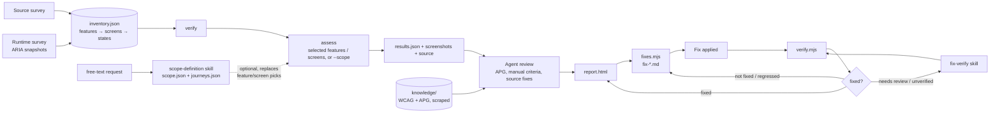

| Layer | Tool | Role |
|---|---|---|
| Static analysis | [axe-core](https://github.com/dequelabs/axe-core) on Playwright | Rule-based WCAG checks, scoped to one screen |
| Real-time analysis | [AbleDOM](https://github.com/microsoft/abledom) | Watches the DOM and focus while the screen is driven: lost focus, hidden focus targets, missing labels |
| Interaction checks | Playwright | Keyboard walk (on overlays starting from the element focused on open), focus visibility and obscuring, traps, overlay Escape and focus return, 320 px reflow, text spacing |
| Knowledge | Scraper | Fetches WCAG 2.2 criteria and APG patterns into `knowledge/`. Nothing from the standards is stored in git |
| Judgement | Agent | APG conformance, visual and manual criteria, finding the source file, writing fixes |

Findings fall into four kinds. Optional requirements are **never** failures.

| Kind | Meaning |
|---|---|
| `failure` | Violates a success criterion at or below the selected level (default AA) |
| `review` | The engine couldn't decide (axe *incomplete*, clipped text under text spacing) |
| `suggestion` | AAA, best practice, or APG guidance with no criterion attached |
| `dismissed` | A false positive triaged by the agent (hidden from the report) |

## Installation

This repository holds four standard [Agent Skills](https://agentskills.io) and a
[Claude Code plugin](https://code.claude.com/docs/en/plugins) wrapper around them. The plugin
wrapper is `.claude-plugin/` plus a setup hook in `hooks/`.

- `accessibility-assessment` is the core skill. It owns the npm dependencies and the WCAG/APG
  knowledge cache.
- `fix-verify`, `scope-definition` and `screen-reader-validation` are companions. They load
  Playwright and shared code from `../accessibility-assessment`, so **install all four skills
  together, as sibling folders**.

Requirements: Node.js 20+, npm, and network access on first setup. Setup fetches npm packages
(through your existing npm configuration; this repo does not set a registry), Playwright Chromium,
and the WCAG 2.2 + APG pages from w3.org. First setup can take several minutes.

Setup is one idempotent command, `npm run setup` (that is, `node scripts/ensure-setup.mjs`), run in
the `accessibility-assessment` folder. It installs only what is missing:

- npm dependencies;
- Playwright Chromium;
- the `knowledge/` cache.

If another setup run is in progress, it waits for that run instead of installing twice. The skills
also run it as their step 0, so a missed setup is fixed on first use. `npm run setup:check`
reports what is missing without installing anything.

### Option 1: Install with `skills` (Recommended)

Vercel's [`skills`](https://github.com/vercel-labs/skills) CLI installs skills into the native
locations of supported agents.

Install globally for your user:

```bash
npx skills add jurokapsiar/acc-assess --skill '*' --global --yes
```

Install only for the current project by omitting `--global`:

```bash
npx skills add jurokapsiar/acc-assess --skill '*' --yes
```

To target specific agents, add `--agent` followed by one or more agent IDs:

```bash
npx skills add jurokapsiar/acc-assess --skill '*' --agent claude-code cursor --global --yes
```

`--skill '*'` installs all four skills. To install a subset, name them, for example
`--skill accessibility-assessment scope-definition`. Always include `accessibility-assessment`.

After installation, run setup from the installed `accessibility-assessment` directory. The CLI
prints the location. Examples: `~/.agents/skills/accessibility-assessment` (global, shared),
`~/.claude/skills/accessibility-assessment` (global, Claude Code only), or
`.claude/skills/accessibility-assessment` (project, Claude Code only).

```bash
cd ~/.agents/skills/accessibility-assessment   # or the path the CLI printed
npm run setup
```

See the [`skills` CLI documentation](https://github.com/vercel-labs/skills) for supported agents
and options.

### Option 2: Claude Code Plugin

Install through Claude Code's plugin system to get automatic updates and team distribution:

```bash
# Add this repository as a marketplace
/plugin marketplace add jurokapsiar/acc-assess

# Install the plugin
/plugin install acc-assess@acc-assess
```

On Claude Code 2.1.275 or later, one step also works:
`/plugin install acc-assess --marketplace jurokapsiar/acc-assess`.

**Setup is automatic.** The plugin's `SessionStart` hook runs `ensure-setup.mjs` in the background
when a session starts. It installs whatever is missing in the installed plugin copy and is a no-op
otherwise. A plugin update installs into a new version folder, so the hook sets that folder up again.
Chromium is cached in `~/.cache/ms-playwright`, so it is not downloaded again. If the agent uses a
skill before the background run finishes, its step 0 waits for that run. Hook output goes to
`.cache/setup.log` in the skill folder.

To run setup by hand, use the installed copy under `cache/`, not the clone under `marketplaces/`.
Only the `cache/` copy is the one Claude Code runs:

```bash
cd ~/.claude/plugins/cache/acc-assess/acc-assess/<version>/skills/accessibility-assessment
npm run setup
```

Skills from the plugin are namespaced, for example `/acc-assess:accessibility-assessment`. Pick
one install method: installing through both the plugin and `skills` lists every skill twice.

### Option 3: Other Agent Installations

Agent Skills are supported by Claude Code, Cursor, GitHub Copilot, Codex, Gemini CLI, OpenCode
and other clients. Install the directories that contain `SKILL.md`, at the client's documented
skill path. If a client has no installer:

1. Copy all four `skills/*/` folders, side by side, into its skill directory.
2. Run `npm run setup` in `accessibility-assessment/`.

### Option 4: Download Release

1. Download and extract the latest release from
   [GitHub Releases](https://github.com/jurokapsiar/acc-assess/releases).
2. Copy the four folders in `skills/`, keeping them side by side, to:
   - Global: `~/.claude/skills/` (for example `~/.claude/skills/accessibility-assessment`)
   - Project: `/path/to/your/project/.claude/skills/`
3. Go to the assessment skill directory and run setup:
   ```bash
   cd ~/.claude/skills/accessibility-assessment  # or your project path
   npm run setup
   ```

### Optional: real screen readers

`screen-reader-validation` runs everywhere with its mock driver. Real NVDA or VoiceOver runs need
its optional `@guidepup/guidepup` dependency:

1. Run `npm install` in the `screen-reader-validation` folder.
2. Run `node scripts/sr.mjs preflight` to see what else is needed.

See [Screen reader validation](#screen-reader-validation).

### Verify Installation

1. Check setup: `npm run setup:check` in the `accessibility-assessment` folder prints `ready`.
2. Check the agent sees the skills:
   - Claude Code plugin: `/plugin` lists `acc-assess` as enabled, and typing `/acc-assess:`
     autocompletes the four skills.
   - Other installs: the agent's skill list shows them.
3. Optionally, run `npm test` in `accessibility-assessment`, `scope-definition` and
   `screen-reader-validation`. The tests use local fixtures and need no app.
4. Start your app, then ask the agent something simple, such as
   *"Run an accessibility assessment of the home page at http://localhost:3000"*.

## Quick Start

After installation, start your app and ask your agent to assess it. The agent:

1. Builds or updates `.a11y/inventory.json` (features, screens, states).
2. Runs axe-core, AbleDOM and the Playwright interaction checks.
3. Reviews the results against WCAG 2.2 and APG.
4. Writes `.a11y/reports/<timestamp>/report.html`, with screenshots, failed criteria, repro steps
   and `fix-*.md` files.

These skills never edit your source code. Fixes are applied by you or by a separate agent step.

## Usage Examples

- *"Run an accessibility assessment of http://localhost:5173"*
- *"Update the a11y inventory, then assess only the settings dialog on desktop and mobile"*
- *"Scope the assessment to the invite dialog and its validation error"*
- *"What should we test for accessibility in this PR?"*
- *"Check WCAG compliance of the checkout flow at AAA"*
- *"Verify the fix in .a11y/reports/<timestamp>/fix-…md"* (after the fix is applied and the app is running)
- *"Check the checkout journey with NVDA"* / *"validate the invite dialog with VoiceOver"*

## Command-line walkthrough

The scripts the agent runs, if you want to drive them yourself:

```bash
cd <your-app>        # app must be running
# 1. Inventory: ask the agent to build .a11y/inventory.json (see "Feature and screen discovery")
node <skill>/scripts/inventory.mjs validate
node <skill>/scripts/inventory.mjs verify --viewport desktop,mobile

# 2. Assess: prints the run folder, .a11y/reports/<timestamp>/ (UTC)
node <skill>/scripts/assess.mjs --viewport desktop,mobile

# 3. Agent review: summarise the run (instead of reading results.json whole), write
#    annotations.json + agent-findings.json in the run folder, then re-render
node <skill>/scripts/summary.mjs .a11y/reports/<timestamp> [--rule id] [--screen id] [--json]
node <skill>/scripts/report.mjs .a11y/reports/<timestamp>

# 4. Fix files: one fix-*.md per rule + component, "ready" when annotations.json has reviewed changes
node <skill>/scripts/fixes.mjs .a11y/reports/<timestamp>

# 5. After the fix is applied (by you or a separate skill; these skills never edit source)
#    and the app runs with it, verify it (fix-report.html)
node <skill>/scripts/verify.mjs .a11y/reports/<timestamp>/fix-<kind>-<source>-<rule>--<component>.md
```

The report lands in `<your-app>/.a11y/reports/<timestamp>/report.html`, next to `fix-*.md` and `fix-report.html`.

## Feature and screen discovery

The skill keeps a map of the app, `.a11y/inventory.json`, so any subset can be assessed reproducibly. It is committed with the app and updated whenever the UI changes.

```
feature ─┬─ states        feature-wide: theme.dark, locale.ar, mode.fluent …
         └─ screens ─┬─ type    page | view | dialog | popover | menu | drawer | panel | toast
                     ├─ parent  a dialog's parent is the screen that opens it
                     ├─ steps   how to get there      ready  how to know it's there
                     ├─ scope   CSS selector limiting analysis to this screen
                     ├─ patterns  APG slugs the screen implements
                     └─ states  each with optional steps and `requires: ["feature.state"]`
```

Dialogs, menus and popovers are screens. A screen's state can depend on a feature's state: "task editor, dark theme" requires `theme.dark`.

### Discovery process

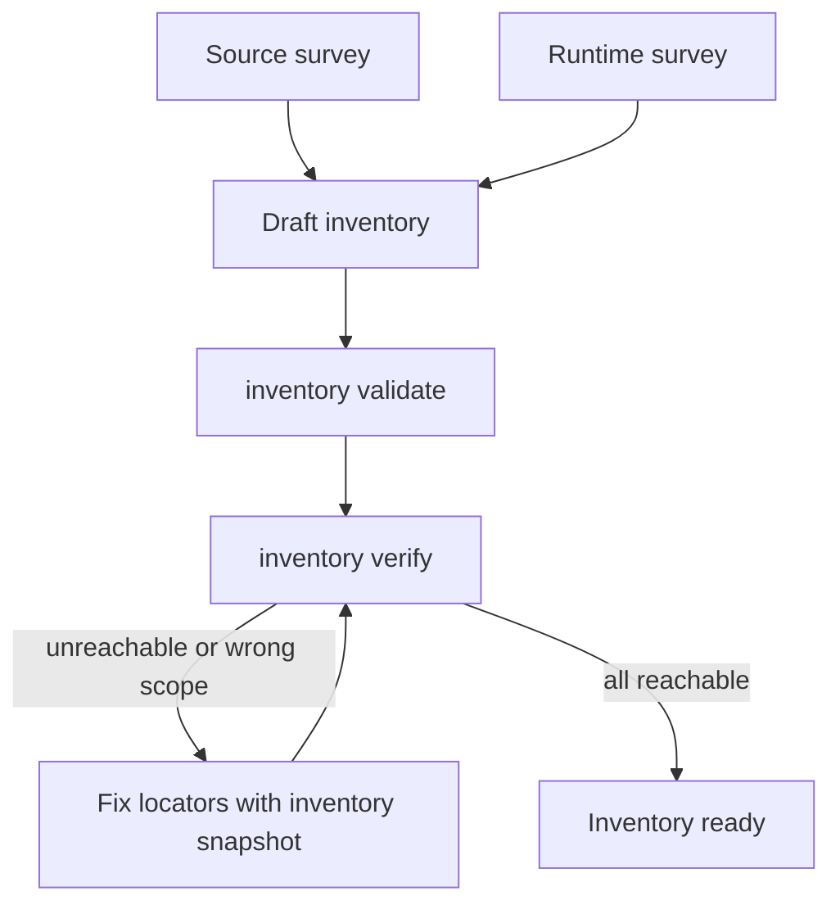

Two surveys, run one after the other by default (or in parallel if your runtime supports workers; each only reports, and the coordinator writes `inventory.json`):

| Survey | What it reads | What it records |
|---|---|---|
| **Source** | Routes, navigation components, dialog/menu/popover components, theme and locale providers, test ids, `package.json` scripts | Features, candidate screens, the trigger for each overlay, global states, start command, `source` file paths |
| **Runtime** | An ARIA snapshot of the live page, and again after opening each trigger | Real roles and accessible names for locators, overlays that actually open, `scope` selectors |

**Runtime survey.** `inventory snapshot` prints the accessibility tree, so locators are written from what assistive technology sees rather than from CSS:

```text
$ node scripts/inventory.mjs snapshot --url http://localhost:3000/
- link "Skip to main content":
  - /url: "#main-content"
- complementary "Sidebar":
  - tablist "Sidebar mode":
    - tab "Base UI" [selected]
    - tab "Fluent UI"
  - button "Task workspace demo": Task workspace All components in a working interface
  - navigation "Base UI components":
    - list:
      - listitem:
        - button "Switch Forms Binary toggle control…"
```

Opening a trigger and snapshotting the overlay gives its `ready` locator and `scope`:

```text
$ node scripts/inventory.mjs snapshot --screen task-actions-menu --scope "[role=menu]"
· Open http://localhost:3000/
· Click button “Task workspace demo”
· Wait until heading “Your work” is visible
· Click button “More actions…”
· Wait until menu is visible
- menu "More actions for mv":
  - menuitem "Unpin task"
  - menuitem "Delete task"
```

The lines starting with `·` are the plan the runner replays. The same text becomes the repro steps in the report.

**Verification.** `inventory verify` runs every plan, checks that `ready` is visible and `scope` exists, and saves a screenshot per screen:

```text
$ node scripts/inventory.mjs verify
✓ home__default__desktop
✓ workspace__fluent__desktop
✓ create-task__default__desktop
✓ task-actions-menu__default__desktop
✓ delete-task-dialog__default__desktop
…
20/20 reachable.
```

| Task actions menu | Delete confirmation dialog |
|---|---|
| 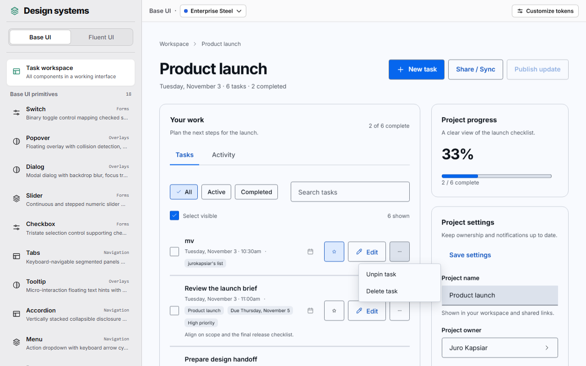 | 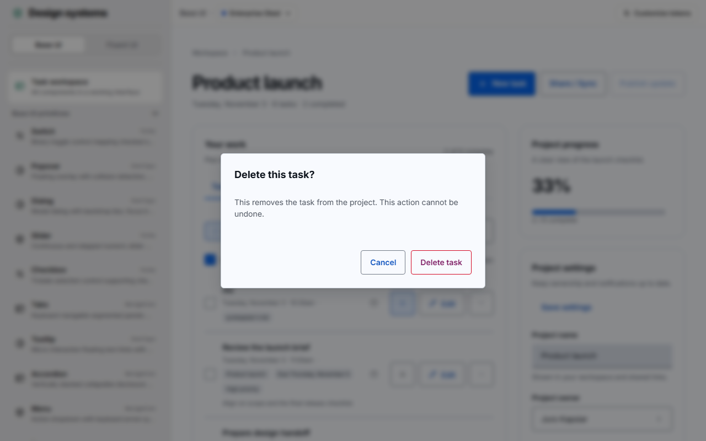 |

Targets that can't be reached are fixed before any assessment runs. An unreachable screen never silently passes.

**Maintenance.** When a feature is added or removed, update its entries. Ids are stable, because reports and annotations reference them. `inventory list` prints the tree:

```text
theme  Theme presets
  ◇ theme.dark  Dark theme
  - home [page] Default view  states: dark, fluent  patterns: tabs, switch
    - theme-preset-listbox [popover] Theme preset listbox  patterns: combobox, listbox
task-workspace  Task workspace
  - workspace [page] Task workspace  states: dark, fluent, name-error
    - create-task [dialog] Create task editor  patterns: dialog-modal, combobox
    - task-actions-menu [menu] Task row actions menu  patterns: menu-button
      - delete-task-dialog [dialog] Delete task confirmation  patterns: alertdialog
```

Full schema: [`references/inventory.md`](skills/accessibility-assessment/references/inventory.md).

## Assessment

Select what to assess: features, screens, states and viewports. The runner expands the selection into targets (screen × state × viewport):

```bash
node <skill>/scripts/assess.mjs --feature task-workspace --viewport desktop,mobile
node <skill>/scripts/assess.mjs --screen create-task,delete-task-dialog --state default,dark
node <skill>/scripts/assess.mjs --screen create-task --dry-run      # print the plans only
```

For each target:

1. Open an isolated browser context with AbleDOM injected before the page loads.
2. Replay the plan: root URL → required feature states → each parent screen → the screen's own steps → the state's steps.
3. Screenshot the settled screen.
4. Run axe-core scoped to the screen's `scope`. Crop and highlight every failing node.
5. Walk the keyboard with Tab. Record the tab order, and check focus visibility, obscured focus, traps and dialog focus handling.
6. Wait for AbleDOM's real-time findings. Merge them with axe, dropping duplicates.
7. For overlays, check that Escape closes them and focus returns to the trigger.
8. Check reflow at 320 px and text spacing.

Transient UI such as menus can close when a screenshot or scroll happens, so the runner replays the plan if the screen disappears.

Hardening gates (details in [`SKILL.md`](skills/accessibility-assessment/SKILL.md) and [`results-schema.md`](skills/accessibility-assessment/references/results-schema.md)):

- `results.json` is validated on write and on every read; invalid input fails closed.
- Targets that were not reached (`error`/`blocked`/`not-attempted`) make the run **partial**: a banner appears and unchecked criteria read "Not evaluated".
- `report.mjs` checks the rendered page in Chromium before replacing `report.html` (`--no-check` skips it).
- Findings outside the requested scope are marked potentially out of scope (engine signal + agent `scope`), listed separately and kept out of counts, fixes and verification.
- `--setup <module>` / `--cdp <loopback endpoint>` let an app-specific skill supply its own browser wiring; non-fresh isolation and interventions are disclosed and cap verification.
- Modality runs and `scope.mjs explore` append `steps.jsonl` incrementally.

Coverage per criterion, including what is left to the agent or a human: [`references/criteria-coverage.md`](skills/accessibility-assessment/references/criteria-coverage.md).

## What failed: examples from the sample app

**An axe failure: visible text isn't part of the accessible name (2.5.3).** The element is highlighted on the full screen, cropped for the report, and numbered in the annotated screenshot.

| Cropped element | Annotated screen |
|---|---|
| 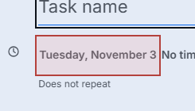 | 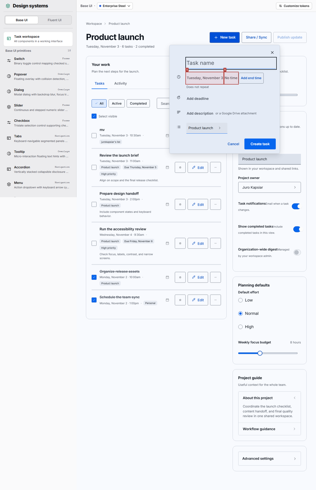 |

The button's text is "Tuesday, November 3", but its `aria-label` is "Change task date". Speech-control users who say "click Tuesday, November 3" won't reach it. The fix is to begin the `aria-label` with the visible text.

**The keyboard tab order.** Each stop is numbered, so the agent can judge focus order against the visual layout (2.4.3, 1.3.2).

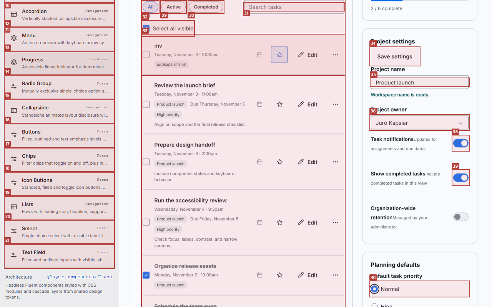

**Findings that need a human or agent.** axe returns *incomplete* results when it can't decide, for example a toggle whose name comes from a nearby label. These become **Needs review**, not failures.

## The report

`report.html` is a single static page: grayscale with pastel section tints (kind chips, not left-border stripes), no gradients, responsive down to 320 px, print-friendly. A page header (app/standard/date/engines) is followed by a sticky section nav (Summary, Criteria, Issues, Review, Suggestions, Scope, User journeys) with a skip link and a current-section highlight; sections have `scroll-margin` so a jump-to-section or Tab never lands under the nav. Issues are grouped by rule; each unique element is listed once with the other screens it appears on.

**Summary** has three half-donut gauges — issues by occurrences, success criteria status, and screens with issues — each a plain 2–4 segment arc with its total inside and a legend of counts/links beside it (not below), followed by a connected table of every issue/review/suggestion row — no cards here, just the counts and links down to them.

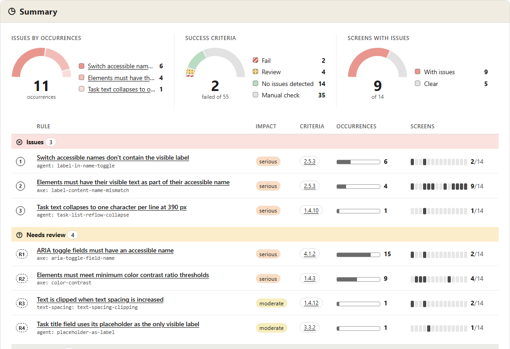

**Success criteria** pairs a half-donut status gauge (*Fail*/*Review*/*No issues detected*/*Manual check*, total inside the arc) with a compact breakdown table beside it (by principle, by level: total/fail/review counts), and the full 55-criterion table as a collapsible fallback below. The report never says "Pass", because automation can't prove a criterion is met.

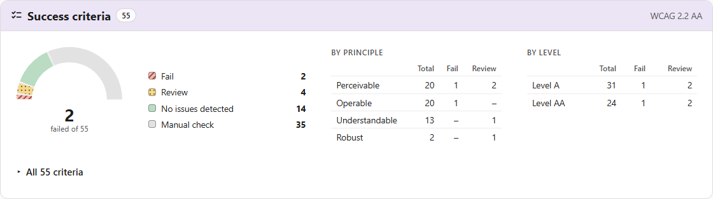

**Issues** are white-bodied cards with a reddish-tinted title row carrying a numbered marker and a kind chip, impact, criterion, rule and fix; **Needs review** cards tint their title row amber and **Suggestions** stone — only the title row is tinted, the body (fix, occurrences, screenshots, repro steps) stays neutral. Each section (title row + body) reads as a single bordered box.

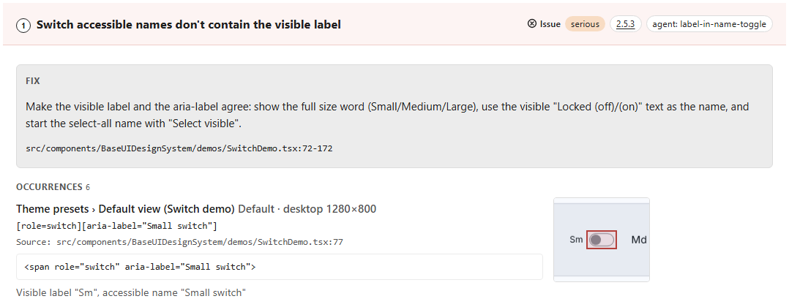

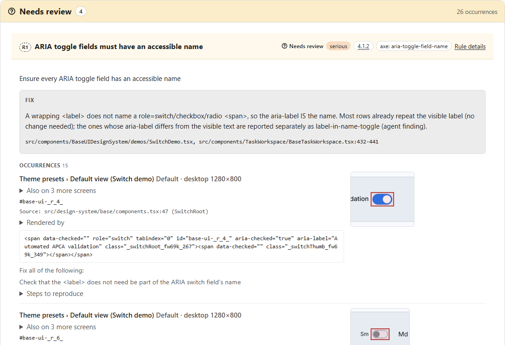

**Scope** is a left rail + main pane, both inside one unified box below the scope meters: the rail lists every screen in the inventory (features → screens → subscreens, whether or not it's been assessed yet) under a single top-level master toggle per overlay layer (issues, tab stops, scope boxes) — no duplicate per-view toggles. Each toggle sits next to a small plain ring (no centre text) showing how much of the total it represents for the currently selected rail entry, with the percentage and count as plain text beside it, updating live as the selection changes (pure CSS `:has()`, no script). Each assessed state × viewport is a selectable rail entry carrying a failure-count badge; unassessed ones read "Not assessed". Selecting an entry shows it large in the main pane. Clicking the screenshot opens it full screen (keyboard-trapped, Esc to close, focus returns to the thumbnail) with its own one-row controls and a disclosure listing that view's issues (rule, title, impact, SC, linked to the issue card). Navigation and every toggle are CSS-only (`:has()`/radios/`<details>`); the only script opens the full-screen `<dialog>`, and a `<noscript>` link keeps the screenshot reachable without it.

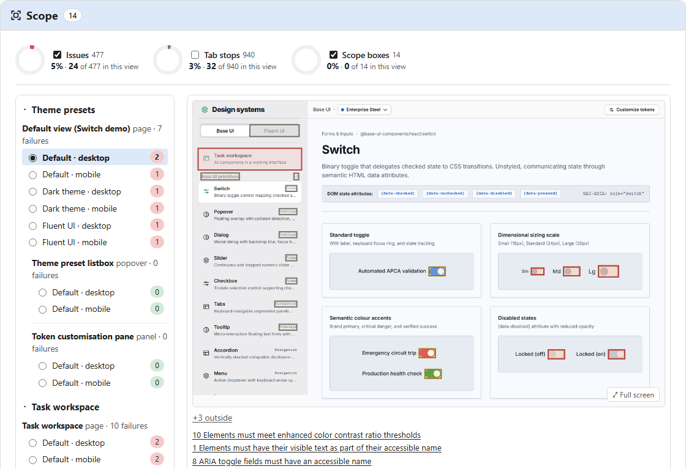

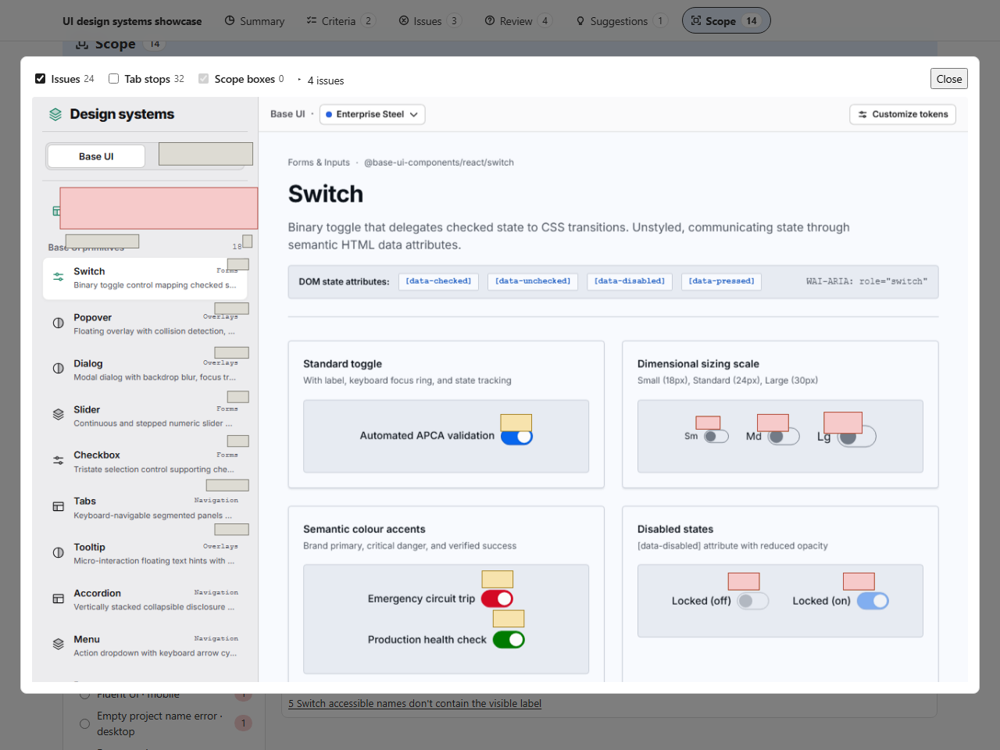

**User journeys** sits directly below Scope — same pastel title row and single bordered box, nav entry included — and only renders when the run has journeys: from a scope's `journeys.json`, or from inventory screens that have their own `steps` when there's no scope. Each journey is a short deterministic narrative built from the steps actually executed ("Opens Host fixture; opens Host dialog, clicks Open dialog…"), with text-only links to the screens it visits — clicking one reuses the exact full-screen `<dialog>` the Scope section opens for that screen's screenshot, no duplicate markup. Below the narrative, a compact list gives every actionable element the journey touches: its accessible name, role, the input used (mouse click, a keyboard key, typing…) and the action executed.

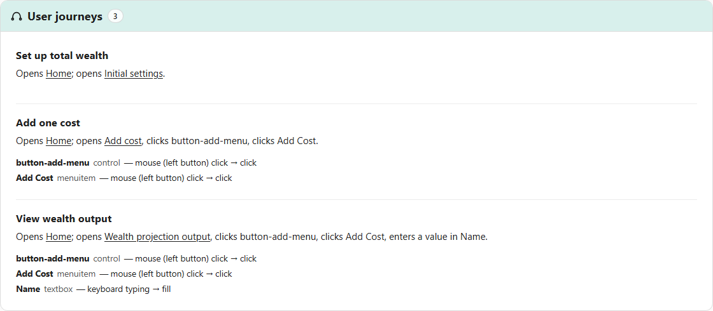

On a phone the layout collapses to one column, with the header stacking to a single column above the sticky nav:

| Summary | Issue |
|---|---|
| 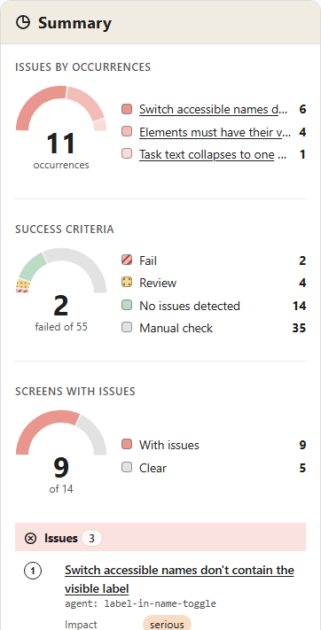 | 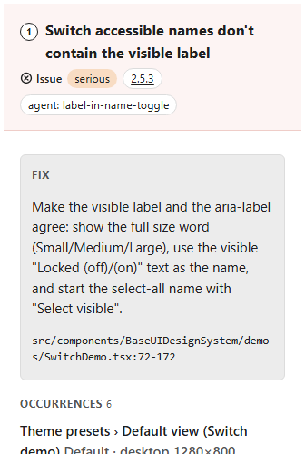 |

## Agent review

Automated engines cover only part of WCAG. After `assess`, the agent works through each screen:

1. Reads `results.json` and the screenshots.
2. Reads `knowledge/apg/<slug>.md` for each pattern in the screen's `patterns`, drives the documented keyboard interactions with Playwright, and compares roles, states and properties. A deviation that breaks a criterion is a failure; anything else is a suggestion.
3. Does the manual checks in [`references/manual-review.md`](skills/accessibility-assessment/references/manual-review.md).
4. Finds the source: each finding node carries a `source` field (`{ file, line, component, … }`) resolved automatically by `assess.mjs` when possible (see [Source tracking](#source-tracking)); the agent greps the screen's `source` list only when that's unresolved, and uses `source.chain` when `source.file` is a shared wrapper component. Writes `annotations.json` (fixes, reviewed changes, dismissals) and `agent-findings.json` (new findings).
5. Re-renders the report:

```bash
node <skill>/scripts/report.mjs .a11y/reports/<timestamp>
```

```jsonc
// annotations.json: keyed by finding id or rule id
{
  "label-content-name-mismatch": {
    "fix": "Start aria-label with the visible text",
    "why": "Speech-control users who say the visible label can't reach the control.",
    "reviewed": true,
    "changes": [{ "file": "src/editor/Toolbar.tsx", "line": 88, "endLine": 88, "proposed": "aria-label=\"Save draft\"" }]
  },
  "F0012": { "kind": "dismissed", "note": "Decorative in production" }
}
```

## Source tracking

With `--source auto` (the default for `assess.mjs`), every finding node is traced back to the
file and line it came from — no code changes required in dev mode. The resolver tries, in
order: dev-inspector data attributes, Svelte/Vue dev metadata, React owner stacks + source maps,
then Angular component names; `via: "none"` means nothing resolved and the agent grep-falls-back
as before. On a real run against the sample app, React's owner-stack resolution located **100%**
of finding nodes with no configuration:

```jsonc
"source": { "via": "react-owner-stack", "file": "src/components/Sidebar/Sidebar.tsx", "line": 48, "component": "Sidebar" }
```

`--source off` skips tracking entirely. `--source-root` overrides where paths are reported
relative to. Full resolver order and the optional build-time plugins for prod-like builds:
[`references/source-tracking.md`](skills/accessibility-assessment/references/source-tracking.md).

## Fix files

`fixes.mjs` turns reviewed (or not-yet-reviewed) findings into one Markdown file per rule and
component, written next to `report.html`:

```bash
node <skill>/scripts/fixes.mjs .a11y/reports/<timestamp>
```

Each `fix-<kind>-<source>-<rule>[--<component>].md` covers the elements one component renders
(by source file + component name; elements without a known source share the rule-only file), so
it stays small and verifies on its own. It has the issue, criterion, every occurrence with its source
location and a before screenshot, repro steps, and a trailing `a11y-verify` JSON block the
verifier reads. Its `Status` is **`ready`** once the rule's `annotations.json` entries have
`reviewed: true` and at least one valid `changes` entry (existing file, line range inside it) —
otherwise it's a **`draft`**, and the command prints what's missing. It also warns when a change
drops text an inventory step locates by, and a full re-run removes fix files that are no longer
produced. A real draft excerpt:

```markdown
# Fix: label-content-name-mismatch

| Status | draft |
|---|---|
| Issue | `failure:axe:label-content-name-mismatch` · serious |
| Component | — (no source; all elements of this rule) |
| WCAG | 2.5.3 Label in Name (A) |
| Occurrences | 1 element on 1 target |
| Report | [report.html#issue-label-content-name-mismatch](report.html#issue-label-content-name-mismatch) |

## Fix
Add a fix recommendation and mark reviewed:true in annotations.json

## Changes
No reviewed change supplied.

No source location known; grep for: `button[aria-label="Change task date"]`

Next: add `changes` (`[{file, line, endLine, proposed}]`) and `reviewed: true` for "label-content-name-mismatch" in annotations.json, then re-run fixes.mjs.

## Occurrences
| # | Where | Element | Source | Before |
|---|---|---|---|---|
| 1 | settings__default__desktop | `button[aria-label="Change task date"]` | — |  |
```

## Fix-verify

Fix-verify only verifies; it never applies or reverts a fix. Once the fix has been applied (by you
or a separate skill, in place or in a copy/branch served at the same `baseUrl`) and the app is
running with it, `verify.mjs` re-runs the same checks
against just the fix file's targets (stopping early if one can't be reached), relocates each listed
element in the live page, and decides
`fixed | not fixed | regressed | unverified | needs review`:

```bash
node <skill>/scripts/verify.mjs .a11y/reports/<timestamp>/fix-<kind>-<source>-<rule>--<component>.md
```

It appends the attempt to `fix-report.json` and renders `fix-report.html` with the same palette,
header and sticky nav as `report.html`: a green-tinted Fixes section, a Summary with a
verification-status ring and a proof-elements ring, and before/after proof crops per issue:

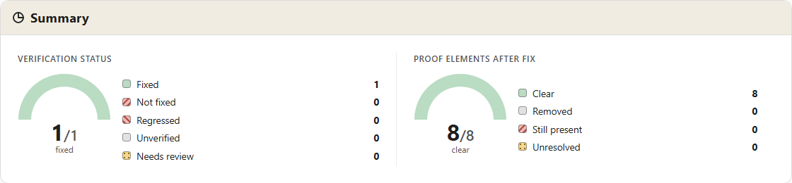

Exit code `0` means every given fix file verified as fixed; `1` means at least one is still
broken or something regressed; `2` means at least one needs a human/agent judgement call
(`needs review`) or couldn't be relocated (`unverified`); `3` is a usage error. The companion
**[`skills/fix-verify`](skills/fix-verify/SKILL.md)** skill owns the workflow for those `2`-exit
cases: replaying repro steps, recording a verdict, and re-rendering with `verify.mjs --render-only`.

## Scoped runs

To assess only a specific flow or change instead of hand-picking `--feature/--screen/--state`,
the companion **[`skills/scope-definition`](skills/scope-definition/SKILL.md)** skill turns a
free-text request ("scope the assessment to the invite dialog and its validation error", "what
should we test for this PR") into a replay-verified `scope.json` + `journeys.json` pair:

```text
scope-definition  --scope-->  assess.mjs --scope  --results.json-->  report.mjs/fixes.mjs  --fix-*.md-->  verify.mjs (fix-verify)
```

```bash
cd <your-app>
node <scope-definition-skill>/scripts/scope.mjs init --prompt "…" --url http://localhost:3000 --id my-scope
node <scope-definition-skill>/scripts/scope.mjs preflight --session my-scope
node <scope-definition-skill>/scripts/scope.mjs intent --session my-scope --template   # the agent fills it in from the prompt…
node <scope-definition-skill>/scripts/scope.mjs intent --session my-scope --from intent.json   # …and the script validates it
node <scope-definition-skill>/scripts/scope.mjs ground --session my-scope
# … explore + step (agent-driven), then:
node <scope-definition-skill>/scripts/scope.mjs propose --session my-scope
node <scope-definition-skill>/scripts/scope.mjs confirm --session my-scope --approved-by <name>    # human confirm gate
node <scope-definition-skill>/scripts/scope.mjs verify --scope .a11y/scopes/<id>/scope.json

node <skill>/scripts/assess.mjs --scope .a11y/scopes/<id>/scope.json
```

`assess.mjs --scope`, `inventory.mjs --scope` and `fix-verify`'s `verify.mjs` (which forwards a
baseline's scope automatically) all consume the same two files unchanged. Because a scope only
*restricts* what runs, independent scopes for different flows can be defined and assessed in
parallel without conflicting (each writes its own `.a11y/scopes/<id>/` and reports under its own
run folder); only an explicit `scope.mjs merge` into the shared `inventory.json` is serialized.
The skill never edits app source and never auto-applies anything: every scope needs a human
approval before it can be verified or assessed.

## Screen reader validation

The companion **[`skills/screen-reader-validation`](skills/screen-reader-validation/SKILL.md)**
skill replays the journeys of a scope (`scope.json` + `journeys.json`, unchanged) with a real
screen reader through [Guidepup](https://www.guidepup.dev/): **NVDA** on Windows, **VoiceOver**
on macOS (auto-selected by OS, `--reader` to override, `mock` for tests without a screen reader).
For every step it records the action (click with mouse button, press with key, navigation …), the
narration before and after, and a screenshot. Deterministic heuristics then turn the narration
into `sr-*` findings (see [rules.md](rules.md#screen-reader-checks-guidepup)): unlabelled or
role-less controls, missing states, unannounced dialogs, status messages and errors, focus not
moved into or returned from a dialog, silent navigation, duplicated or verbose speech, reading
order, missing landmarks and headings.

```bash
cd <your-app>
node <sr-skill>/scripts/sr.mjs preflight                 # checks OS, Guidepup, NVDA/VoiceOver, permissions; prints what to do
node <sr-skill>/scripts/sr.mjs run --scope .a11y/scopes/<id>/scope.json [--journey <id>] [--storage-state <file>]
# → .a11y/sr-runs/<timestamp>/results.json + sr-report.html (Summary, Session log, Issues)
node <sr-skill>/scripts/sr.mjs analyse .a11y/sr-runs/<timestamp>         # re-run the heuristics + re-render
node <sr-skill>/scripts/sr.mjs report  .a11y/sr-runs/<timestamp>         # re-render only
```

`preflight` never installs anything or changes system settings: it prints the exact command
(`npm install` in the skill, `npx @guidepup/setup install nvda|voiceover`, the one-time
`npx @guidepup/setup` machine setup on macOS, …) or settings path for you to run. Speech is
captured around each action through Guidepup (phrases arriving later are kept as the step's
"late" narration); every step records its capture health, and failures on steps whose speech
could not be captured reliably, partial text matches, non-modal dialogs and error text inferred
from class names are reported as **review**, not failure. Typed values in sensitive fields are
refused (the journey is `blocked`), other typed values are redacted from `results.json` and the
report. `run` exits `2` when a journey is partial or blocked. Findings use the assessment
finding shape (`source: "screen-reader"`) so they can later be merged into `report.html`.

## Interaction modalities

A journey (or `--modality`) states how it must be operated: `keyboard`, `mouse`, `sr-keyboard`
or `sr-navigation`; without one, runs are unchanged. Under `keyboard` only Tab, Shift+Tab, the
arrow keys, Enter and Space navigate and activate, and the mouse and programmatic focus are
banned until the agent is stuck. Needing either is a **failure** (`kbd-*`, WCAG 2.1.1/2.1.2/2.4.3)
with repro, screenshot and a `fix-<issue>.md`. `sr-keyboard` applies the same rules through a screen
reader; `sr-navigation` also allows reader navigation, where what the reader cannot find is a
**review** ("point to verify"). The reports show a modality badge. NVDA runs now establish browse
mode before probes, discard sweeps that ran in focus mode and fail closed when the browser is not
verified as foreground.

```bash
node <skill>/scripts/assess.mjs --scope .a11y/scopes/<id>/scope.json --modality keyboard [--max-presses 120] [--no-escalate]
node <sr-skill>/scripts/sr.mjs run --scope .a11y/scopes/<id>/scope.json --modality sr-keyboard,sr-navigation
```

Rules: [rules.md](rules.md#interaction-modality-checks). Touch is not automated.

## Repository layout

```text
.claude-plugin/                   plugin.json + marketplace.json (Claude Code plugin wrapper)
hooks/hooks.json                  plugin SessionStart hook: runs ensure-setup.mjs in the background
skills/
├── accessibility-assessment/
│   ├── SKILL.md                  workflow, CLI, report format
│   ├── references/               inventory schema, criteria coverage, manual-review checklist, source tracking
│   ├── scripts/
│   │   ├── ensure-setup.mjs      idempotent setup (`npm run setup`): deps, Chromium, knowledge/
│   │   ├── fetch-knowledge.mjs   scrapes WCAG 2.2 + APG into knowledge/
│   │   ├── inventory.mjs         list | validate | verify | snapshot
│   │   ├── assess.mjs            runs the checks, writes results.json
│   │   ├── report.mjs            renders report.html, merges agent input
│   │   ├── fixes.mjs             generates fix-*.md from results + annotations
│   │   ├── verify.mjs            re-checks a fix against the live app, renders fix-report.html
│   │   ├── summary.mjs           read-only run overview: counts, failed criteria, top issues, fix files
│   │   └── lib/                  inventory, steps, WCAG data, AbleDOM, checks, source tracking, verification
│   ├── tests/                    node:test suites + local HTML/React fixtures (`npm test`)
│   └── knowledge/                 generated, git-ignored
├── fix-verify/
│   ├── SKILL.md                  workflow for needs-review / unverified fix results
│   └── references/                version policy, relocation tiers, decision table
├── scope-definition/
│   ├── SKILL.md                  text -> scope.json + journeys.json, replay-verified
│   ├── references/                scope.json / journeys.json / intent.json schema, producer interface
│   ├── scripts/
│   │   ├── scope.mjs              init | preflight | intent | ground | explore | step | propose |
│   │   │                          confirm | verify | replay | merge | login | status
│   │   └── lib/                  intent parsing, grounding, explore/replay, journeys, producers/
│   └── tests/                    node:test suites (`npm test`)
└── screen-reader-validation/
    ├── SKILL.md                  journeys replayed with NVDA / VoiceOver via Guidepup
    ├── references/                drivers + permissions, narration heuristics, results.json schema
    ├── scripts/
    │   ├── sr.mjs                 preflight | run | analyse | report
    │   └── lib/                  session, analyse, rules, report, preflight, drivers/ (nvda, voiceover, mock)
    └── tests/                    node:test suites with the mock driver + fixture app (`npm test`)
docs/images/                      screenshots used in this README
rules.md                          catalog of every rule id, its criteria, engine and kind
new-tools.md                      proposed tooling for the gaps
```

### Releasing

Plugin users get an update only when `version` in `.claude-plugin/plugin.json` changes. Bump it,
and `metadata.version` in each `SKILL.md`, together. Tag the commit and publish a GitHub release
for Option 4 (a publishing GitHub Action is planned, see [`TODO.md`](TODO.md)).
