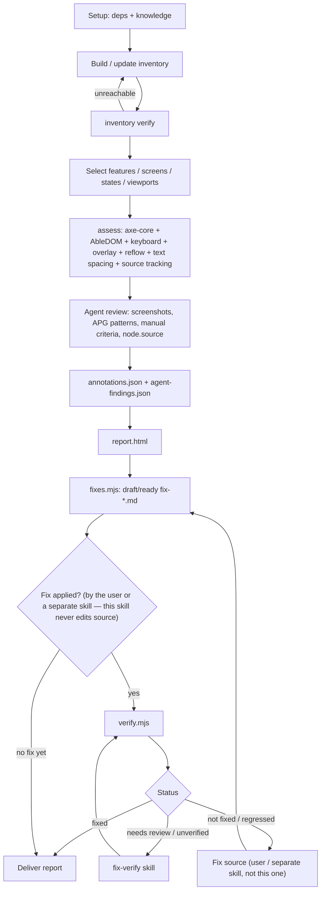

# Accessibility Assessment

Assess a running web application against WCAG 2.2 and the WAI-ARIA Authoring Practices (APG). Combine automated engines with agent review, then deliver a report developers can act on.

## Scope of Application

- Web apps that run in a browser: SPAs, server-rendered sites, component libraries.
- Whole apps, or **selected features / screens / states**.
- Screens include pages, views, dialogs, menus, popovers, drawers, panels and toasts.
- States are variations of a screen: theme, locale, error, empty, expanded, and so on. They can depend on feature-level states.

## Prerequisites

- Node.js 20+.
- **Step 0, every session:** make sure setup is complete. The script is idempotent: it installs
  only what is missing (npm deps, Playwright Chromium, the WCAG 2.2 + APG `knowledge/` cache), and
  if another setup run is in progress (for example the Claude Code plugin's background hook), it
  waits for it instead of installing twice:
  ```bash
  node <skill-dir>/scripts/ensure-setup.mjs          # same as `npm run setup` in <skill-dir>
  ```
  `knowledge/` is generated and git-ignored. Re-run `npm run knowledge` in `<skill-dir>` to refresh it.
- The target app must be running and reachable. If it isn't, start it and record the command in `app.start` in the inventory.
- If Chromium can't be installed, pass `--channel msedge` or `--channel chrome`.
- Long-running commands (`ensure-setup.mjs` / `npm run setup` on first run, `npm run knowledge`, `assess.mjs`, `verify.mjs`, `scope.mjs verify`) can take minutes. Give them a generous timeout (10+ minutes) or run them in the background and poll their output; don't kill them early or re-run them concurrently into the same run folder.

All commands below run **from the target app root**:

```bash
node <skill-dir>/scripts/<script>.mjs …
```

Outputs go to `.a11y/` in the target app:

| Path | Content | Commit? |
|---|---|---|
| `.a11y/inventory.json` | Features, screens, states | Yes |
| `.a11y/inventory-shots/` | Screenshots from `inventory verify` | No |
| `.a11y/reports/<timestamp>/` | `results.json`, `shots/`, `report.html`, agent inputs, `fix-*.md`, `verify/`, `fix-report.json`/`fix-report.html`. `<timestamp>` is UTC (`YYYY-MM-DD-HH-MM-SS`); the last line of `assess.mjs` output prints the path | No |

## Workflow



## Step 1: Build and maintain the inventory

The inventory is the map of the app. Keep it current: add screens when features change, and remove ones that are gone. Full schema: [references/inventory.md](references/inventory.md).

```
feature ─┬─ states        (feature-wide: theme.dark, locale.ar, auth.admin …)
         └─ screens ─┬─ type: page | view | dialog | popover | menu | drawer | panel | toast | other
                     ├─ parent        (a dialog's parent is the screen that opens it)
                     ├─ steps / ready (how to get there, how to know it's there)
                     ├─ scope         (CSS selector limiting analysis to this screen)
                     ├─ patterns      (APG pattern slugs the screen implements)
                     └─ states ── requires: ["feature.state"] + own steps
```

### 1.1 Discover

Do discovery yourself, one survey after the other (single agent is the default). If your runtime supports parallel workers, you may run the two surveys concurrently with any capable model, but follow the single-writer rule below.

| Survey | Collects |
|---|---|
| Source survey | Routes, navigation, top-level features, dialogs/menus/popovers and their triggers, global states (theme, locale, mode, auth), existing test ids, start command and port |
| Runtime survey | `inventory snapshot --url <baseUrl>`, plus snapshots after opening each trigger, to confirm accessible names, roles and reachable overlays |

Turn the results into inventory entries:
- Prefer role + accessible-name locators (`{ "role": "button", "name": "Save" }`). These double as checks that the names exist.
- Use `"/regex/"` names for dynamic labels.
- Give every overlay a `scope` that matches exactly one element (for example `[role=dialog][aria-label="New project"]`), a `ready` locator and `patterns`. Check it with `inventory snapshot --screen <id> --scope <css>`.
- Set `"modal": false` on non-modal dialogs and popovers.
- Express cross-feature dependencies with `requires`. For example, a screen state "dark" requires `theme.dark`. States aren't inherited: a child dialog needs its own `dark` state to be assessed with `--state dark`.

### 1.2 Validate and verify

```bash
node <skill-dir>/scripts/inventory.mjs validate   # schema, ids, parents, requires
node <skill-dir>/scripts/inventory.mjs verify     # runs every plan (first viewport; add --viewport desktop,mobile), checks ready + scope, saves screenshots
node <skill-dir>/scripts/inventory.mjs list       # tree view
node <skill-dir>/scripts/inventory.mjs snapshot --screen <id> [--state <id>] [--scope <css>]
```

Fix every unreachable target before assessing. Use `snapshot` to see what the page actually exposes.

## Step 2: Select and assess

Confirm the selection with the user: features, screens, states, viewports and level (default: all screens, all their states, first viewport, AA).

```bash
node <skill-dir>/scripts/assess.mjs --feature checkout --viewport desktop,mobile
node <skill-dir>/scripts/assess.mjs --screen settings,delete-account-dialog --state default,dark
node <skill-dir>/scripts/assess.mjs --screen settings --dry-run     # print plans only
```

| Option | Default | Notes |
|---|---|---|
| `--inventory` | `.a11y/inventory.json` | |
| `--feature`, `--screen`, `--state` | all / all / all | Comma-separated ids; `default` is every screen's base state. Omit `--state` for all states; a state id no selected screen has prints a warning |
| `--viewport` | first in inventory | `desktop,mobile` … |
| `--target` | — | Comma-separated target keys (`<screen>__<state>__<viewport>`), for example to re-run exactly the targets a `fix-*.md` lists. Expands to every inventory viewport first, then intersects with `--feature/--screen/--state/--viewport`. Any key that doesn't resolve aborts the whole run (exit 1), listing what didn't match — no partial runs |
| `--scope` | — | A `scope.json` from `skills/scope-definition` (or hand-written, see `references/inventory.md`): overlays its journeys' screens/states into the inventory in memory, then assesses exactly `scope.targets` (still intersected with `--feature/--screen/--state/--viewport` if also given). A conflicting overlay aborts with nothing run; `results.json` records `scope: { file, id, sha256, journeysSha256, producers, intent }` |
| `--storage-state` | `inventory.app.storageState` | Path to a Playwright storage-state JSON (auth cookies/localStorage), used for every `browser.newContext`. Content is never read by this skill beyond handing the path to Playwright |
| `--setup` | — | Module with optional hooks (`launch`, `newContext`, `beforeTarget`, `afterTarget`, `teardown`, `export const isolation`) for apps that need runtime setup. See "Integrating from an app-specific skill" |
| `--cdp` | — | Attach to an already running Chromium (loopback endpoints only). The run never closes a browser it did not launch and is disclosed as not a fresh context |
| `--no-check` | off | `report.mjs` only: skip the rendered-report check (Chromium is launched once per render otherwise) |
| `--level` | `AA` | `A`, `AA`, `AAA`. Criteria above the level become suggestions |
| `--checks` | all | `axe,abledom,keyboard,overlay,reflow,text-spacing` |
| `--source` | `auto` | `auto` resolves each finding node's source file/line (see below); `off` skips it entirely (faster, no `node.source`) |
| `--source-root` | — | Base directory source paths are reported relative to. Defaults to `inventory.app.sourceRoot`, else the app root (cwd) |
| `--workers` | `2` | Parallel browser contexts |
| `--channel`, `--headed` | | Browser selection, debugging |
| `--max-tabs` | `40` | Keyboard walk length |
| `--out` | `<inventory dir>/reports` | |
| `--modality` | step/journey `modalities`, else none | `keyboard`, `mouse` (comma-separated): extra guarded replays; keyboard bans the mouse and programmatic focus until the step is stuck, then reports a failure with repro, screenshot and fix. `sr-*` belong to `screen-reader-validation` (exit 3 here). See [references/modalities.md](references/modalities.md) |
| `--max-presses`, `--max-escalations`, `--no-escalate` | `120`, `10`, off | Keyboard search bound, escalation cap (run becomes `partial`), never fall back to mouse/focus |

**Interaction modalities.** A journey step can declare how it must be operated (`keyboard`, `mouse`, `sr-keyboard`, `sr-navigation`). Needing the mouse or a programmatic focus move for a `keyboard` step is a failure (`kbd-*` rules, WCAG 2.1.1/2.1.2/2.4.3), reported like any issue, with a `fix-<issue>.md`. Details and rules: [references/modalities.md](references/modalities.md). Touch is never automated; disclose it as untested.

**Results contract and gates.** `results.json` has a documented, validated shape ([references/results-schema.md](references/results-schema.md)). `assess.mjs`, `report.mjs`, `fixes.mjs`, `summary.mjs` and `verify.mjs` validate it and fail closed (exit 1, listing the problems) instead of rendering a broken report. A target that could not be reached is `error`, `blocked` or `not-attempted` with a reason; a run with any such target is a **partial run**: the report shows a banner and criteria without findings are "Not evaluated", never "No issues detected". `report.mjs` renders to a temp file, checks it in Chromium (no `[object Object]`/`undefined`/`NaN`, images load, overlay rects are finite, every rail entry selects its panel, the full-screen dialog opens and closes with Esc) and writes `report-check.json`. A failed check keeps the previous `report.html` and leaves `report.failed.html`; do not hand a report to the user unless the check passed.

**Scope triage.** Every finding is checked against the requested scope: the engine marks nodes outside the screen's `scope` selector (`scopeSignal`), and the agent can override per finding with `"scope": "in" | "potentially-out"` and a `scopeNote` (required on agent findings; allowed in `annotations.json`). Potentially out-of-scope findings are not counted, not turned into fixes (unless `fixes.mjs --include-out-of-scope`) and are listed in a collapsed "Potentially out of scope" section and an optional overlay layer. `summary.mjs` reports `outOfScope.scopeUnreviewed`; it must be `0` (the agent has confirmed or overridden every automatic out-of-scope decision) before delivering results.

**Integrating from an app-specific skill.** This skill is app-agnostic. An app-specific skill owns fixture discovery, mock auth, routes and proxies; it hands them over as a setup module:

```js
// my-setup.mjs   node scripts/assess.mjs --setup my-setup.mjs
export const isolation = 'fresh-context';          // or 'shared-context' | 'reused-page'
export async function newContext({ browser, options, target }) {
  const context = await browser.newContext(options);
  await context.route('**/api/**', (route) => route.continue());   // app-specific wiring goes here
  return context;
}
export async function beforeTarget({ context, page, target }) {}
export async function afterTarget({ context, page, target, status }) {}
// target.addIntervention({ step, kind, reason }) records any setup action taken inside an assessed state
```

Rules: `--setup` cannot be combined with `--storage-state` when the module exports `newContext`. Anything other than `fresh-context`, and any recorded intervention, is written to `results.execution`, shown as a report banner, caps `verify.mjs` at `unverified` (never `fixed`) and makes modality runs with an intervention `partial`. Hook errors print the message only; cookies, headers and storage state are never logged. `scope.mjs verify|replay|explore` accept the same `--setup`/`--cdp`.

**Incremental evidence.** Modality runs (and `scope.mjs explore`) append one line per action to `steps.jsonl` (`{ts, target, step, key, pageUrl, focused, outcome}`), flushed before the next action, so earlier observations survive a later failure. Focus probes time out after 1 s (`outcome: "focus-timeout"`).

**Scoped runs.** To assess only a specific flow or change ("the invite dialog and its validation error", "what should we test for this PR") instead of hand-picking `--feature/--screen/--state`, use the sibling `skills/scope-definition` skill to turn a free-text request into a `scope.json` + `journeys.json` pair, then pass `--scope <scope.json>` here. `inventory.mjs list|validate|verify` accept the same flag. `fix-verify`'s `verify.mjs` re-verifies a scoped baseline with the same scope automatically — see its SKILL.md.

**Source tracking.** With `--source auto` (the default), every finding node gets a `source` object: `{ via, file, line, column, component, chain, unresolved }`. `file`/`line` point at the exact source location when the app runs in dev mode (React, Svelte, Vue) or exposes dev-inspector data attributes; `via: "none"` means nothing resolved, and the agent should grep as before. Full resolver order and path rules: [references/source-tracking.md](references/source-tracking.md).

What each target (screen × state × viewport) gets:

| Check | Engine | Finds |
|---|---|---|
| Static rules | axe-core (scoped to `scope`) | Names, roles, contrast, structure, ARIA validity, target size … |
| Real-time | AbleDOM (injected before load) | Focus lost, focus on hidden elements, labels, missing ids, nested interactive elements, as the DOM changes |
| Keyboard walk | Playwright | Focus not moved into a dialog (or, for review, into a non-modal overlay), invisible focus, traps, obscured focus, escaping a modal, unreachable controls. On overlay screens the element focused on open is recorded as tab stop `0` (selector, box, source, crop); `tabOrderNote` says when Tab leaves the overlay at once (arrow keys not measured) or nothing focusable was reached |
| Overlay | Playwright | Escape closes it; focus returns to the trigger |
| Reflow | Playwright @ 320 px | Horizontal scrolling (1.4.10) |
| Text spacing | Playwright | Clipped text with WCAG spacing (1.4.12) |

Coverage per criterion: [references/criteria-coverage.md](references/criteria-coverage.md).

## Step 3: Agent review

Automated engines cover only part of WCAG. For each assessed screen, do the following. Review screens one at a time by default. Optionally, if your runtime supports parallel workers, split the screens across them, giving each worker the paths below; workers only **report** findings and the coordinator is the **single writer** of `annotations.json` and `agent-findings.json` (concurrent writers overwrite each other). Never let two workers write the same artifact.

1. **Read the evidence.** Start with `node <skill-dir>/scripts/summary.mjs <run> [--rule id] [--screen id] [--json]` (counts by kind/rule/screen/target, failed criteria, top issues with an example source file, fix files); only open `results.json` for the details of specific findings or targets. Look at `shots/<target>.png` (full screen), `shots/<target>__cut.png` (the screen's crop) and, when the target's `tabOrderShot` isn't `null`, `shots/<target>__taborder.png` (numbered focus order). `results.json` is large; don't read it whole.
2. **Check APG conformance.** For every slug in the screen's `patterns`, read `<skill-dir>/knowledge/apg/<slug>.md`. Replay the target's `repro` steps with Playwright (or the Playwright MCP), press the listed keys and compare the roles, states and properties.
   - A deviation that breaks an SC (for example 2.1.1 or 4.1.2) is a `failure`.
   - Any other deviation from APG guidance is a `suggestion`.
3. **Do manual checks** from [references/manual-review.md](references/manual-review.md) for every screen, whatever the report status: "No issues detected" only means no check found anything.
   - Read the criterion text in `<skill-dir>/knowledge/wcag/<num>-<id>.md`.
   - Don't report what you can't observe; leave it as a manual check.
4. **Locate the source.** Use each node's `source` field when it resolved (`source.via !== "none"`): `source.file:source.line` is the exact location, `source.component` names the owning component, and `source.chain` (React) shows the full owner chain when the fix belongs higher up (props/usage, not the host element). When `source.file` is a shared design-system wrapper (the same file:line for every button/switch), the call site to change is usually the first `source.chain` entry after the wrapper (the report and fix files list it as the owner chain). When `source.via === "none"` (unresolved), fall back to grepping the screen's `source` files for selectors, classes and labels, as before. Write concrete fixes against the code, not generic advice.
5. **Triage false positives.** Mark them `dismissed` with a `note`. Dismissal works per finding id (one rule on one target, all its nodes) or per rule id (everywhere), not per node: when only some nodes of a rule are genuine, leave the engine finding as is and report the genuine ones as an agent finding.
6. **Check fixes don't break the inventory.** A fix that changes an accessible name used by an inventory locator (for example removing a mismatched `aria-label`) makes that plan unreachable after the fix. Prefer `"/regex/"` names in the inventory for such controls, and mention it in the fix's `why`. `fixes.mjs` flags a change whose current lines contain a literal step name/label/text that its proposed text drops, and lists the affected targets.

Write the results next to `results.json`:

```jsonc
// annotations.json – keyed by finding id ("F0007") or rule id ("color-contrast")
{
  "label-content-name-mismatch": {
    "fix": "Start aria-label with the visible text: aria-label=\"Save draft\"",
    "why": "Speech-control users who say the visible label can't reach the control.",
    "sourceFile": "src/editor/Toolbar.tsx:88",   // optional: shown under the fix in report.html
    "reviewed": true,                       // required (on every annotation of the group), with valid "changes", for "ready"
    "changes": [{ "file": "src/editor/Toolbar.tsx", "line": 88, "endLine": 88, "proposed": "aria-label=\"Save draft\"" }]
  },
  "F0012": { "kind": "dismissed", "note": "Decorative, aria-hidden in production build" }
}
```

- A rule-id key applies to every finding with that rule, whatever its engine (`tabindex` and `nested-interactive` exist in both axe and AbleDOM). Use finding ids to target one engine.
- `changes[].file` is relative to the source root (same as `node.source.file`). `line`..`endLine` is replaced by `proposed` (all lines, with indentation); to delete a line, leave it out of `proposed`.
- Any field in an annotation overrides the finding's own (for example `"kind": "failure"`), so don't set fields you don't mean to change.
- `report.html` shows `fix` and `sourceFile`; `why` and `changes` appear only in the fix files. Dismissal notes aren't shown anywhere but `annotations.json`.

A rule with no reviewed `changes` stays a `draft` fix file: `fixes.mjs` (Step 4) still generates it, with a note on what to add.

```jsonc
// agent-findings.json – same shape as results.findings; kind: failure | review | suggestion
[{
  "target": "settings__default__desktop", "kind": "failure", "rule": "non-text-contrast", "scope": "in",   // "in" | "potentially-out" (+ optional "scopeNote"): required
  "title": "Input borders below 3:1", "impact": "serious", "wcag": ["1.4.11"],
  "nodes": [{ "selector": "input[name=email]", "summary": "#d4d4d4 on #ffffff = 1.5:1", "screenshot": "shots/settings__default__desktop.png" }],
  "repro": ["Open /settings", "Inspect the e-mail field border"],
  "fix": "Use a border color with at least 3:1 against the background, e.g. #8a8a8a.", "pattern": null
}]
```

Agent findings get ids `agent-1`, `agent-2` … (by array position) and `source: "agent"`. Give each node a stable `selector` (no hashed classes or generated ids) and, when you know it, `"source": { "file": "…", "line": n }` so the fix file shows the location, and a document-coordinate `"box": { "x", "y", "width", "height" }` to draw it in the Scope view. Agent findings always verify as `needs review` (see Step 5).

Then re-render the report:

```bash
node <skill-dir>/scripts/report.mjs .a11y/reports/<timestamp>
```

## Step 4: Generate fix files

```bash
node <skill-dir>/scripts/fixes.mjs .a11y/reports/<timestamp> [--kinds failure,review,suggestion] [--only rule,rule2]
```

Writes one `<run>/fix-<kind>-<source>-<rule>[--<component>].md` per rule **and component** next to `report.html`: the elements of a rule are split by the component that renders them (`source.file` + `source.component`, or an agent finding's `sourceFile`), for example `fix-failure-axe-button-name--toolbar.md`. Elements with no known source stay together in the rule-only file (`fix-failure-axe-button-name.md`). Two keys that slug alike both get a short hash suffix. Each file has the issue, WCAG criterion, every occurrence with its source location and a before screenshot, repro steps, and a trailing `a11y-verify` JSON block `verify.mjs` reads.

A fix file's `Status` is:
- **`ready`** — every annotation applying to the file's findings has `reviewed: true`, and there is at least one `changes` entry, each with an existing `file`, an integer `line` ≥ 1, an `endLine` (default `line`) inside the file, and a string `proposed`. The file shows the current and proposed code.
- **`draft`** — anything else. The command prints what is missing or invalid; the file lists known source locations and the next step.

Annotations keyed by rule apply to every component file of that rule; each `changes` entry goes to the file whose elements are rendered in `changes[].file`, else one whose owner chain contains it (a call site), else the rule-only file. A component file left without a change stays `draft`.

Suggestion files are marked optional (not required for conformance). Review and agent-sourced files explain the `needs review` → `agent-verdicts.json` route in their Verify section, which shows a command you can run as written.

Re-run `fixes.mjs` any time `results.json` or `annotations.json` changes; it's idempotent (same inputs → same files). It records what it wrote in `fixes-manifest.json`; a full run (no `--only`/`--kinds`) deletes fix files it generated earlier that are no longer produced (for example after dismissing a rule). Files it never wrote are left alone.

A fix file covers its component's occurrences across all targets, so `verify.mjs` reports `fixed` once those are fixed; other components of the same rule are verified by their own files. Use `--only <rule>` to (re)generate the files of selected rules.

## Step 5: Verify a fix

These skills never apply or revert a fix. Once the fix has been applied (by the user or a separate skill) and the app is running with the change:

```bash
node <skill-dir>/scripts/verify.mjs .a11y/reports/<timestamp>/fix-<kind>-<source>-<rule>.md
```

Run it from the same app root as the baseline (`.a11y/inventory.json`, the same `baseUrl`). If the fix was applied in a copy, branch or worktree served at the same `baseUrl`, `informational.filesChanged` in `fix-report.json` then reads `false`, because it hashes the files under the app root.

This re-runs `assess.mjs` against just the fix file's listed targets (all checks; `--quick` limits it to the issue's own check plus the ones it depends on), relocates every listed element in the live page, and appends a verdict — `fixed`, `not fixed`, `regressed`, `unverified` or `needs review` — to `<run>/fix-report.json`, rendering `<run>/fix-report.html`. Exit code: `0` all fixed, `1` any not-fixed/regressed, `2` any unverified/needs-review (and no 1), `3` usage/input error.

A draft fix file can still be verified (useful to check "is it actually fixed yet" before writing up the `changes`), but prefer promoting it to `ready` first so the fix file documents what changed.

`needs review` (a `review`-kind or agent-sourced issue) and `unverified` (stale config, unreachable target, unresolved node) need judgement calls the verifier can't make alone. The companion **fix-verify** skill (`skills/fix-verify`, a sibling of this skill) owns that workflow: replaying repro steps, recording an agent verdict, and re-rendering with `verify.mjs --render-only <run>`.

## Finding kinds

| Kind | Meaning | Examples |
|---|---|---|
| `failure` | Violates an SC at or below the selected level | axe violation tagged `wcag2aa`, focus trap |
| `review` | Possibly violating; the engine couldn't decide | axe *incomplete*, clipped text with text spacing |
| `suggestion` | Optional: above the level, best practice, or APG guidance without an SC | AAA contrast, `tabindex` on non-interactive elements |
| `dismissed` | Agent-triaged false positive (hidden from the report) | |

Optional requirements are **never** reported as failures. Heuristic engine hits (for example a positive `tabindex`) are `review`.

## Output format

`report.html` is self-contained apart from relative screenshot links:
- **Header:** app, standard, date, engines, followed by a sticky section nav (skip link, current-section highlight, CSS-only with a small JS fallback).
- **Summary:** three half-donut gauges (issues by occurrences, success-criteria status, screens with issues — a few segments each, the total inside the arc, counts as a legend beside it) and a connected table linking down to every issue/review/suggestion — no cards, no headline sentence.
- **Success criteria:** a half-donut status gauge (Fail / Review / No issues detected / Manual check, total inside the arc) paired with a compact breakdown table beside it (by principle, by level), with the full criteria table as a collapsible fallback.
- **Issues → Needs review → Suggestions:** white-bodied cards with a reddish/amber/stone-tinted title row (numbered marker, kind chip), grouped by rule, each with impact, SCs, rule details link and fix; the card body stays neutral. Each unique element is listed once with where it occurs (and where else), selector, HTML, summary, repro steps and a cropped screenshot.
- **Scope:** scope meters plus a left rail listing *every* inventory screen (assessed or not, nested feature → screen → subscreen) under single top-level master toggles per overlay layer (issues, tab stops, scope boxes) — no duplicate per-view toggles — all inside one unified box. Each toggle has a small plain ring next to it (no centre text, percentage/count as plain text beside it) showing how much of the total it represents for the current rail selection, updating live via CSS `:has()`. Each assessed state × viewport is a selectable rail entry with a failure-count badge. The main pane shows the selected view large. Clicking the screenshot opens a full-screen view (native `<dialog>`: focus trap, Esc-to-close and focus-return are free) that keeps its own one-row controls plus an issue-count disclosure (rule, title, impact, SC, linked to the issue card). Finding boxes follow `annotations.json` (dismissed findings disappear, re-kinded ones change colour) and include agent findings whose nodes have a `box`. Not-yet-assessed states/screens are still selectable and show "Not assessed", so the rail doubles as a coverage map.

Every section (title row + body) renders as a single bordered box — no separate stacked cards per section.

`fixes.mjs` adds `fix-*.md` files next to `report.html` (one per rule + component); `verify.mjs` adds `verify/<timestamp>/` (a verification re-run's own `results.json` + screenshots) and `fix-report.json`/`fix-report.html` (same palette/header/nav, a green-tinted Fixes section, a Summary with a verification-status half-donut gauge and a proof-elements half-donut gauge; every verification attempt, newest first, with before/after proof crops).

When reporting back to the user, summarise briefly: failed criteria with counts, the top three issues with fixes, and the report path.

## Required capabilities

| Capability | Used for |
|---|---|
| Shell + Node.js | Running the scripts |
| File read/write | Inventory, annotations, source lookup |
| Image viewing | Reviewing screenshots |
| Subagents / parallel workers (optional, any model) | Faster discovery, per-screen review, source lookup |
| Playwright (scripts or MCP) | Ad-hoc interaction during agent review |

## Best practices

### DO
- Keep the inventory in sync with the app. It's what makes selective assessment possible.
- Give overlays a precise `scope`, so findings in the page behind them don't leak in.
- Assess each important state, such as dark theme, errors, empty or loading, and a mobile viewport.
- Cite the SC, the element and the source file in each fix.
- Treat AAA, best practice and APG-only guidance as suggestions.

### DON'T
- Claim conformance. Automated and agent checks can show failures but can't prove a pass.
- Store WCAG or APG text in the repo. Use the scraped `knowledge/`.
- Rely on CSS selectors with generated ids or hashed class names in the inventory.
- Report the same element repeatedly; the report already merges occurrences.

## Troubleshooting

| Problem | Fix |
|---|---|
| `Cannot launch browser` | `npx playwright install chromium` in the skill folder, or `--channel msedge` |
| Target `not reached` | `inventory verify --screen <id>`, then `inventory snapshot` to see the real names; prefer regex names |
| Overlay closes during checks | Make sure `ready` identifies the overlay; the runner replays the plan when it disappears |
| Findings from outside a dialog | Set `scope`; for non-modal overlays set `"modal": false` |
| Knowledge missing / stale | `npm run knowledge` |
| Too many suggestions | Filter with `--checks`, or dismiss rules in `annotations.json` |
| Gaps in coverage | See [references/criteria-coverage.md](references/criteria-coverage.md) and the proposed tooling in the repository's `new-tools.md` |
| `unverified` from `verify.mjs` | Check the printed reason: incompatible config (engine/level/viewport/inventory changed — re-baseline, or `--accept-plan-change` if only a step label changed) or an unresolved node (add a stronger selector/role+name in the inventory, or re-baseline) |
| `unverified (target not reached)` after a naming fix | The fix renamed a control the inventory clicks. Switch that locator to a `"/regex/"` name, then re-run with `--accept-plan-change`. The unreachable run still takes as long as a full re-run |
| No `node.source` on a finding | The app isn't in dev mode, uses a framework without zero-config support, or is a production build; see [references/source-tracking.md](references/source-tracking.md) for the data-attribute plugin options, or fall back to grep |
