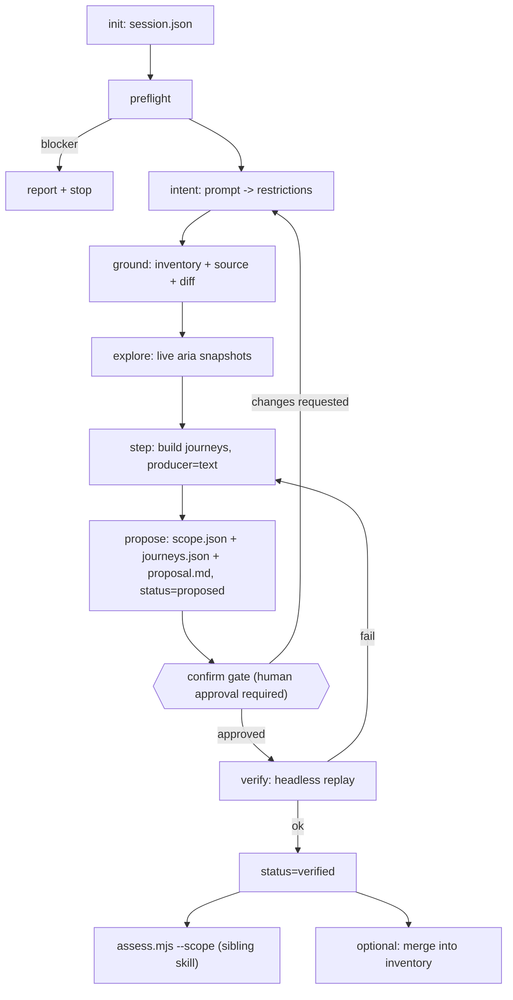

# Scope Definition

Turn a free-text request into two machine-readable, replay-verified artifacts: a **scope**
(exact assessment target keys, with what was excluded or could not be resolved, and why) and
**user journeys** (ordered, replayable steps that reach every scoped screen/state). Both are
consumed unchanged by `skills/accessibility-assessment` (`assess.mjs --scope`) and, through the
baseline run, by `skills/fix-verify` (`verify.mjs`).

The text is a **restriction/filter**: this skill builds context (inventory, source, live
snapshots) for the app but only keeps what the request asks for.

## Scope of application

- "Assess only X", "scope the a11y run to …", "check the flow where the user …", "what should we
  test for this change/PR".
- A screen/state the user describes is **missing** from `.a11y/inventory.json`, or hard to reach
  (a wizard step, an error state after input, a menu inside a dialog).
- Re-using a named scope for a later run or for fix verification.

**Not for:** assessing (that's `accessibility-assessment`), deciding fix status (`fix-verify`),
writing app tests, or changing app source, mocks, fixtures or config.

## Hard rules

1. **Never edit app source, tests, mocks, seeds or config.** Writes are confined to
   `<app>/.a11y/scopes/**` and, only via `scope.mjs merge`, `<app>/.a11y/inventory.json`.
2. **Never invent locators.** Every step `target` needs evidence: a live aria-snapshot reference,
   a source location, or an existing inventory locator. A step without evidence is refused by
   `scope.mjs step`, never silently recorded.
3. **Inventory is additive-only** from this skill. Existing ids are never overwritten; a
   conflicting id is reported, nothing is written for it.
4. **Human confirm gate** before a scope becomes usable. A non-interactive agent stops at
   `proposed` and reports; it never approves its own proposal.
5. **Replay is the acceptance test.** A target is `verified` only after a fresh, headless browser
   context replays its compiled plan with no agent/recorder present.
6. **No secrets, ever.** Password/secret-labeled fields are refused as step targets; auth is a
   `storageState` file path only, never values (see "Auth and secrets" below).

## Prerequisites

This skill has no dependencies of its own: it borrows the sibling `accessibility-assessment`
skill's Playwright install and shared libraries (same convention as `fix-verify`).

```bash
cd <accessibility-assessment-skill-dir> && npm run setup   # once, if not already done
```

The target app must be running and reachable at `inventory.app.baseUrl` (or `--url`).
`scope.mjs preflight` checks this and reports exactly what's missing.

All commands run **from the target app root**:

```bash
node <scope-definition-skill-dir>/scripts/scope.mjs <command> …
```

## Files and layout

```
<app>/.a11y/scopes/<scope-id>/
  scope.json          committable   exact target keys + excluded/unresolved + approval + verification
  journeys.json       committable   replayable steps, split into inventory screens/states
  proposal.md         committable   human-readable review sheet (generated, re-generated on propose)
  work/               gitignored    session.json, preflight.json, intent.json, grounding.json,
                                    snapshots/*.yml, shots/*.png, verify/*.png, merge.lock
```

Add `.a11y/scopes/*/work/` and `.a11y/auth/` to the app's ignore guidance alongside the sibling
skill's `.a11y/reports/`.

## Workflow



Every command reads/writes `work/session.json` (a state machine, written atomically). Phases run
in order (`init → preflighted → intent → grounded → explored → proposed → confirmed → verified
→ merged`); re-running an earlier phase is allowed only with `--force` and invalidates later work.

| Command | Purpose | Writes |
|---|---|---|
| `init --prompt "…" [--url] [--source-root] [--base\|--changed\|--diff] [--inventory] [--viewport] [--storage-state] [--id]` | Start a session | `work/session.json` |
| `preflight [--insecure] [--channel]` | Node/Playwright/Chromium, inventory, app reachability, source root, git ref, storageState checks | `work/preflight.json` |
| `intent [--from <intent.json>]` | Deterministic prompt → baseline restrictions | `work/intent.json` |
| `ground [--no-source] [--no-diff] [--limit n]` | Score candidates from the inventory, source tree and diff | `work/grounding.json` |
| `explore (--screen id [--state id] \| --url p) [--steps f] [--viewport v] [--headed]` | One bounded live probe (aria snapshot + screenshot) | `work/snapshots/`, `work/shots/` |
| `step --journey <jid> [--checkpoint screen\|state …] [--action … --evidence …]` | Record one checkpoint/step into the session draft | session draft |
| `propose` | Compile the draft into `scope.json` + `journeys.json` + `proposal.md` | the three committable files |
| `confirm --approved-by <name> [--yes]` | **The human confirm gate.** Records who approved and when | `scope.json.approval` |
| `verify --scope <f> [--viewport all\|v1,v2] [--headed] [--channel]` | Headless replay of every target; the acceptance test | `scope.json.verification`, `work/verify/` |
| `replay --scope <f> --target <key> [--headed]` | Manual, read-only replay of one target for inspection | none |
| `merge --scope <f> [--inventory f] [--dry-run]` | Optional: fold a verified scope into the inventory | `inventory.json` |
| `login --save <file> --url <loginUrl> [--channel]` | Headed, manual login; saves a Playwright storage state | the storage-state file |
| `status --session <s> \| --scope <f>` | Print phase/targets/verification | none |

**Modality flags on `step`** (optional; see `references/schema.md`): `--modalities keyboard,sr-keyboard`
(sets the journey's modalities), `--intent activate|reach|…`, `--keys "Tab,Tab,Enter"` (explicit key
script), `--modality-skip <modality> --reason "…"` (not attempted, reported for review). Modalities
named in the request ("keyboard only", "without a mouse", "with NVDA") are parsed by `intent`, shown
in `proposal.md` and inherited by journeys; "touch" is disclosed as not covered. `focus`/`evaluate`
steps in a keyboard or screen-reader journey need `--reason` because they are reported as
programmatic intervention. `scope.mjs verify` is unchanged (it proves reachability, not operability).

Every command takes `--session <id>` (all except `verify`/`replay`/`merge`, which take
`--scope <file>` instead) and an optional `--app-root` (defaults to cwd). Exit codes: `0` ok,
`1` error/blocker, `2` partial/conflict, `3` usage.

## Grounding guidance for the agent

`scope.mjs ground` is **advisory**, not a decision-maker: it scores how well each phrase in the
parsed intent matches inventory ids/names, source strings/routes/test ids, and diff-changed
files. The agent makes the actual call:

- Read `work/grounding.json`'s `byPhrase` candidates. A phrase with one strong candidate (clearly
  above the others) is an easy match. A phrase with no candidate above the floor, or two within
  0.1 of each other, needs the agent's judgment (and possibly `explore` to look before deciding).
- For a large app, delegate inventory-matching and source-matching to separate subagents (they
  are independent reads); only the main agent calls `step`/`propose` (single writer of
  `session.json`).
- Locator preference when building a `step`: role+accessible-name (exact) > label > role/label
  `within` a stable container > test id > text > placeholder > CSS selector. Positional (`--nth`)
  or CSS (`--selector`) targets are allowed but require `--reason`, and are marked with a lower
  confidence that blocks `status: verified` until the agent either tightens the locator or
  accepts the risk.
- **States are not inherited.** A new state on a parent screen does not automatically apply to
  its child dialogs/menus/popovers; model each as its own state with `--requires` if the request
  implies it should apply everywhere.
- A bare `--checkpoint screen --id <existing-id>` (no object, just an id) only re-visits an
  existing screen as a pivot for a `--checkpoint state` that follows it - it carries no steps of
  its own. To interact with something already on an existing screen, attach the action to a new
  **state** segment on that screen, not to the revisit itself.

## Output files

See [references/schema.md](references/schema.md) for the full field reference of `scope.json`,
`journeys.json` and `intent.json`. In short: `scope.json.targets` is the authoritative list of
`<screen>__<state>__<viewport>` keys; `journeys.json` compiles into an inventory-shaped overlay
(new screens/states) that the sibling skill applies in memory, never on disk, until an explicit
`merge`.

## Handoff to assessment and fix-verify

- `assess.mjs --scope <scope.json>` (sibling skill) runs exactly `scope.targets`, intersected
  with any `--feature/--screen/--state/--viewport` also given; `results.json` records
  `scope: { file, id, sha256, journeysSha256, producers, intent }`.
- `inventory.mjs list|validate|verify --scope <f>` use the same in-memory overlay.
- `fix-verify`'s `verify.mjs` forwards a baseline's `results.scope` automatically when re-running
  a fix check; a missing scope file is `unverified (scope file not found)`, never a silent
  fallback to the bare inventory.
- `scope.mjs replay --scope <f> --target <key> --headed` opens a browser at one target and pauses
  for manual inspection (`needs review` items) - read-only, no writes.

## Merge (optional)

`scope.mjs merge` folds a **verified** scope's new screens/states into `.a11y/inventory.json`
permanently. It is never automatic and never required: `assess.mjs --scope` works from the
in-memory overlay alone. Merge is additive-only (append; a different definition for an existing
id is a conflict, nothing written, exit 2) and lock-protected against a concurrent `assess.mjs`
run. Use it when a scope's new screens/states are worth keeping for every future run, not just
this one.

## Auth and secrets

- Auth is a Playwright `storageState` **file path** only (`--storage-state`, or
  `inventory.app.storageState`), conventionally under `.a11y/auth/` and gitignored. Create one
  with `scope.mjs login --save <file> --url <loginUrl>` - headed, the user logs in manually;
  nothing about the login is recorded.
  - `storageState` content is never read, written, or stored in `scope.json` - only the path.
- `scope.mjs step` refuses any target whose label/name/test id matches a password/secret pattern
  (`pass`, `secret`, `token`, `otp`, `pin`, `card`, `cvv`, `ssn`, `iban`). There is no `${env:…}`
  expansion in the runner, so login steps are unsupported in journeys - use `storageState`
  instead.
- Fill values must be synthetic (`not-an-email`, `Test User`); the proposal flags values that
  look data-bound (digits, e-mail shape, dates) and suggests a `"/regex/"` matcher instead for
  anything an assertion depends on.
- `work/` (snapshots, screenshots, session) may contain incidental PII from the live app and is
  gitignored, never transmitted anywhere beyond the local Playwright run.

## Unsupported (MVP)

The skill reports an explicit `unsupported`/`needs-setup` status rather than a plausible-but-wrong
plan for: multiple tabs/popups, cross-origin iframes, closed shadow DOM, canvas-only UI, drag and
drop, file upload, network mocking, server-side fixtures, states needing backend data unreachable
via the UI, arbitrary `evaluate`, and CAPTCHA/MFA. It selects and proves reachability for what the
request asks for; it does not discover the whole app or guarantee coverage of every combination.

## Producers

`step`/`propose` go through a small producer registry so a future **recorder** (headed Playwright
overlay), **codegen** (import a Playwright test file) or **devtools** (import a Chrome DevTools
Recorder session) producer can plug in without touching the propose/confirm/verify/merge path.
MVP ships only the `text` producer (the agent's own `step` calls). See
[references/producers.md](references/producers.md) for the interface and what's planned.

## Troubleshooting

| Symptom | Cause | Fix |
|---|---|---|
| `preflight` blocks on "App not reachable" | Dev server not running, or `app.start`/`--url` wrong | Start the app, confirm the URL, or pass `--insecure` for a self-signed cert |
| `step`/`propose` error: `journey.feature requires an id` | `--feature` was only passed on a later `step` call | Pass `--feature <id>` on a journey's very first `step`/`checkpoint` call; later calls for the same journey reuse it automatically |
| An action step silently doesn't show up in `propose`'s target list | The step was attached right after a bare `--checkpoint screen --id <existing-id>` (a pure revisit) | Revisits carry no steps of their own; attach the action to a `--checkpoint state` on that screen instead |
| `verify` reports `ambiguous` | A step's target matches more than one element | Add `--nth` with `--reason`, or narrow with `within`/a more specific locator |
| `verify` reports `unreachable` | A step's target never appeared, or `ready`/`scope` didn't match after the plan ran | Re-`explore` the screen/state to confirm the current locator still matches; check for a redirect/auth requirement |
| `confirm` fails: `--yes requires A11Y_SCOPE_AUTOCONFIRM=1` | `--yes` is for tests/CI only | Omit `--yes` and record a real human approval, or set the env var only in a test/CI context |
| `merge` reports a conflict | An id the scope introduces already exists in the inventory with different content | Rename the new id, or edit the inventory by hand to match before merging |
| `verify`/`assess.mjs --scope` warns about a stale `journeysSha256` | `journeys.json` was hand-edited after `propose` | Re-run `propose` (or accept the warning if the edit was intentional and re-`verify`) |
