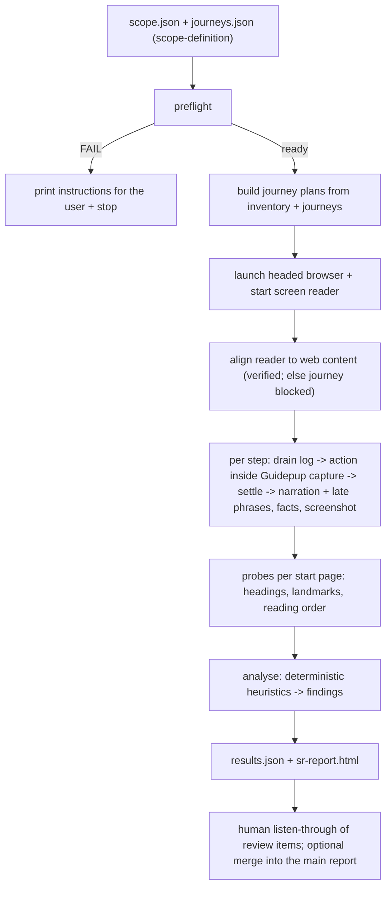

# Screen Reader Validation

Replay the **user journeys** of a scope (`skills/scope-definition` output: `scope.json` +
`journeys.json`, steps in the inventory step format) with a **real screen reader** driven by
[Guidepup](https://www.guidepup.dev/), record what the user would hear at every step, and turn
that narration into findings with deterministic heuristics.

For every step the run records:

- the **action** executed (`goto`, `click` + mouse button, `press` + key, `focus`, `fill`, …) and
  how it was sent (`trace.input`: a Playwright mouse click, a *programmatic* fill/focus/select, or
  OS keys through the screen reader — programmatic operations are labelled as such, never as user
  input);
- the **narration**: the last phrase heard before the action, every phrase Guidepup recorded
  while the action ran and settled, and **late** phrases that arrived before the next action
  (nothing recorded is ever discarded); plus the **capture health** of the step
  (`captured` / `unavailable` / `unaligned` / `simulated`);
- DOM **facts** before/after (focus, open dialogs, live regions, error messages, `aria-controls`
  targets) used to decide what *should* have been announced;
- a **screenshot**.

Guidepup only records speech while a command runs through its queue, so every Playwright action
is wrapped in Guidepup's `capture(...)` and every key press goes through `press(key, {capture:
true})`. When capture can't be verified (no `capture()` in the installed Guidepup, reader not
aligned to the page) the step is marked unreliable and its failures are downgraded to `review`.

After the journeys, one **probe** per distinct start page sweeps headings, landmarks and the
reading order with the reader's own navigation commands; each sweep records its commands and
how it ended (`end`, `cap`, `repeat`, `silent`, `unsupported`, `error`). Incomplete sweeps
draw no conclusions.

## Scope of application

- "Test this flow with NVDA/VoiceOver", "what does the screen reader say when …", "is the error
  announced", "does focus move into the dialog".
- A scope already exists (or is created first with `scope-definition`); journeys are replayed
  exactly as recorded.

**Not for:** defining journeys (`scope-definition`), automated rule scanning
(`accessibility-assessment`), deciding fix status (`fix-verify`), or changing the app.

## Hard rules

1. **Never edit app source, tests, mocks, seeds or config, and never apply fixes.** The skill
   writes only to `<app>/.a11y/sr-runs/<run>/` (or `--out`). Guidepup itself keeps temporary
   reader state outside the run dir (NVDA: its portable config under the Guidepup cache;
   VoiceOver: preference changes it restores on `stop()`); `preflight` lists these side effects.
2. **Never install software or change system settings.** `preflight` checks the environment and
   prints the exact command or settings path for the *user* to run/change; the agent does not run
   `npx @guidepup/setup`, edit the registry/`defaults`, or grant macOS permissions itself.
3. **No secrets, ever.** Authentication is a Playwright `storageState` **file path** only
   (`scope.storageState` or `--storage-state`); a scope `storageState` that doesn't exist is a
   usage error (exit 3), never a silent anonymous run. Typing into a sensitive field (password,
   one-time code, payment `autocomplete`) is **refused** at run time: the journey stops as
   `blocked`. Sensitive fields are masked in screenshots, and every value a journey types is
   replaced by `[redacted]` in results and report (typed-character echo is only redacted when the
   reader speaks the whole value as one string).
4. **One real screen reader session at a time** on an unlocked, interactive desktop, with a
   headed browser in the foreground. Do not touch mouse/keyboard while it runs. Never run several
   real-reader runs in parallel.
5. **Mock narration is not evidence.** `--reader mock` synthesises speech from DOM events to test
   the pipeline; its report is labelled "simulated narration". Only NVDA/VoiceOver runs count.
6. **App-agnostic.** Nothing here may name or special-case a particular application.
7. **Findings are reported, not "fixed".** Heuristic findings with `kind: review` need a human
   listen-through; the report shows the narration as evidence for each one.

## Prerequisites

The skill borrows Playwright and the shared libraries from the sibling `accessibility-assessment`
skill (same convention as `scope-definition` / `fix-verify`), plus Guidepup:

```bash
node <accessibility-assessment-skill-dir>/scripts/ensure-setup.mjs   # step 0, idempotent: Playwright + Chromium + knowledge
cd <screen-reader-validation-skill-dir> && npm install       # optional dependency @guidepup/guidepup
node scripts/sr.mjs preflight                                # tells you what else is needed
```

| OS | Reader | What the user must do once (preflight checks each) |
|---|---|---|
| Windows | NVDA (portable, managed by Guidepup) | From the skill dir run `npx @guidepup/setup install nvda` to download the portable NVDA + Guidepup add-on version that the installed `@guidepup/guidepup` manifest requires, to `%LOCALAPPDATA%\guidepup` (or `GUIDEPUP_SCREEN_READERS_PATH`). No admin rights needed. Run from an interactive, unlocked desktop session (not a service / SSH / locked RDP). An installed or running NVDA is fine: Guidepup stops it for the run and restores it. |
| macOS 12+ | VoiceOver | `npx @guidepup/setup install voiceover` (preferences DMG for this macOS version) and, once, `npx @guidepup/setup` machine setup (or enable *VoiceOver Utility → General → Allow VoiceOver to be controlled with AppleScript*); grant the terminal/IDE **Accessibility** and **Automation → VoiceOver / System Events** in *System Settings → Privacy & Security*. Never disable SIP. Preflight can't verify permissions; it says so. |
| any | `mock` | Nothing. Used by tests and for dry runs. |

The reader is auto-selected by OS (`win32` → `nvda`, `darwin` → `voiceover`, otherwise `mock`);
override with `--reader nvda|voiceover|mock` (`dry-run` is an alias for `mock`). Real readers
always run headed.

## Workflow



All commands run **from the target app root**:

```bash
node <skill-dir>/scripts/sr.mjs <command> …
```

| Command | Purpose |
|---|---|
| `preflight [--reader r] [--channel c] [--json]` | OS, Guidepup install, screen reader assets, permissions, interactive session, headed browser. Exit 1 with instructions when not ready. Writes nothing. |
| `run --scope <scope.json> [--journey a,b] [--reader r] [--viewport v] [--modality m] [--max-presses n] [--max-escalations n] [--no-escalate] [--out dir] [--headed] [--channel c] [--settle ms] [--timeout ms] [--storage-state file] [--skip-preflight] [--app-root d]` | Replay, analyse, render. Preflight runs first for real readers. `--modality sr-keyboard\|sr-navigation\|all` (default: each journey's declared `sr-*` modalities, else the legacy `unspecified` run); `keyboard`/`mouse` are usage errors here (exit 3, they belong to `accessibility-assessment`). |
| `analyse <runDir>` | Re-run the heuristics on an existing `results.json` and re-render. |
| `report <runDir>` | Re-render `sr-report.html` only. |

Exit codes: `0` ok, `1` error / preflight failed, `2` some journeys did not complete (journey
`status` is `complete`, `partial` = a step failed, or `blocked` = not replayable as scoped,
sensitive field refused, or reader alignment failed), `3` usage. Incomplete runs show a warning
banner in the report; "no issues" is never a pass for them.

Typical agent flow:

1. `sr.mjs preflight`. On FAIL, relay the printed `fix` lines to the user verbatim and stop.
2. `sr.mjs run --scope .a11y/scopes/<id>/scope.json` (add `--journey` to narrow).
3. Open `sr-report.html`; for each Issue/Review item, read the narration in the Session log and
   the screenshot before reporting it. Report `kind: review` items as "needs a human check".

## Files and layout

```
<app>/.a11y/sr-runs/<YYYYMMDD-HHMMSSZ>-<reader>/      gitignored
  results.json      run metadata, journeys[].steps[] (action, key/button, narration, facts,
                    screenshot), probes[], findings[], summary
  sr-report.html    Summary · Session log · Issues · Review · Suggestions (self-contained)
  shots/            j<journey>-s<step>.png, p<probe>.png
```

Add `.a11y/sr-runs/` to the app's ignore guidance alongside `.a11y/reports/`.

Findings use the assessment finding shape (`source: "screen-reader"`, `rule`, `kind`
failure|review|suggestion, `impact`, `wcag[]`, `nodes[{selector, html, summary, screenshot}]`,
`repro[]`, `evidence{narration, expected, simulated}`), so they can be merged into the main
report later. See [references/results-schema.md](references/results-schema.md).

## Heuristics

17 narration rules (`sr-*`), each with a WCAG SC, default severity and fix; full logic and limits in
[references/heuristics.md](references/heuristics.md). In short: compare what changed in the DOM
(focus, dialogs, live regions, errors, expanded content) with what the reader actually said.

## Interaction modalities

A journey (or `--modality`) can run as `sr-keyboard` or `sr-navigation`; each journey × viewport ×
modality is a separate run (key suffix `~<modality>`, `modality` in `results.json`, a badge in the
report). Without a modality the run is unchanged (`unspecified`; results `schemaVersion` 2, v1 is
read as `unspecified`).

- **Keys only**: navigation and activation use Tab, Shift+Tab, arrows, Enter and Space, sent
  through the reader. The mouse is banned and programmatic focus is not used until the step is
  stuck; then it is attempted once (unless `--no-escalate`), reported as a **failure** with
  repro, screenshot and fix (`kbd-*` rules, same catalogue as `accessibility-assessment`), and
  the run is partial after `--max-escalations` (default 3). `--max-presses` (120) bounds a search.
- **`sr-navigation`** additionally treats reader-specific navigation (headings, landmarks,
  reading sweeps) as the way to read content; what the reader cannot find is a **review**
  ("point to verify": `srnav-not-reachable`, `srnav-no-semantic-nav`, `srnav-focus-mode-required`),
  never a confirmed app failure, because the reader position cannot be tied to a DOM element.
  Mouse or programmatic focus is still a failure. `sr-autofocus-focus-mode` is a suggestion.
- **NVDA mode handling**: browse mode is established (never blindly: NVDA+Space toggles, so it is
  confirmed by the spoken announcement) before probes and `sr-navigation` read steps; sweeps that
  ended in focus mode are discarded and retried once, then reported as `discarded: reader was in
  focus mode` (proves nothing). The foreground check fails closed
  (`foreground-not-verified`, journey `blocked`) and never sends keys to another window.
- Typing into sensitive fields is refused in every modality.

## Troubleshooting

- **Nothing is spoken / "focus not in web content"**: the browser window was not in the
  foreground. Close other windows, keep the screen unlocked, re-run; increase `--settle`.
- **NVDA asset missing**: run `npx @guidepup/setup install nvda` from the skill dir (user
  action), then `preflight`.
- **VoiceOver "not allowed to send keystrokes"**: grant Accessibility/Automation to the terminal
  app in Privacy & Security and restart the terminal.
- **Journey step failed**: the step's locator no longer resolves; re-verify the scope with
  `scope-definition` (`scope.mjs verify`). This skill never patches journeys.

## Known limits

- Heuristics see narration as text; they cannot judge tone, verbosity settings or braille.
- Clicks go through Playwright mouse events; `fill`/`focus`/`select` are programmatic (labelled
  so) and `type` uses CDP key events; only `press` steps are OS keys sent through the screen
  reader. A reader may react differently to real typing.
- Feature states listed in `requires` are applied before the segment; an unknown reference
  blocks the journey.
- Live regions inserted together with their message are reported (`sr-status-not-announced`) even
  though some reader/browser pairs occasionally announce them.
- Probes run on journey start pages only; deep pages are covered by their journey steps.
- Values typed into ordinary fields remain visible in screenshots (only sensitive fields are
  masked); keep test data non-personal.
- Settle times (NVDA 1200 ms, VoiceOver 1500 ms) and end-of-sweep messages are defaults that need
  confirming on each machine; slow announcements show up as "late" phrases.
- Narration differs between readers, versions and settings; compare runs of the same reader.
- Not validated on a real reader: mode announcements (sounds-only configurations are treated as
  unknown mode), nested key capture through the reader, and name-based reach checks.

References: [drivers.md](references/drivers.md) · [heuristics.md](references/heuristics.md) ·
[results-schema.md](references/results-schema.md)
